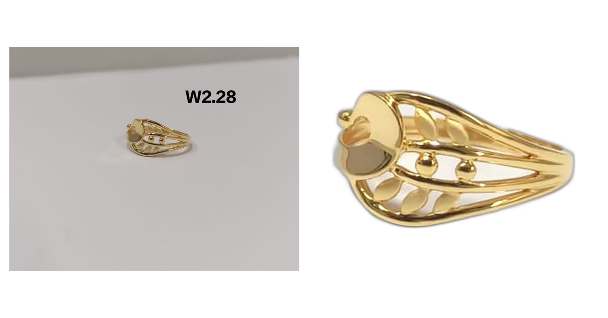
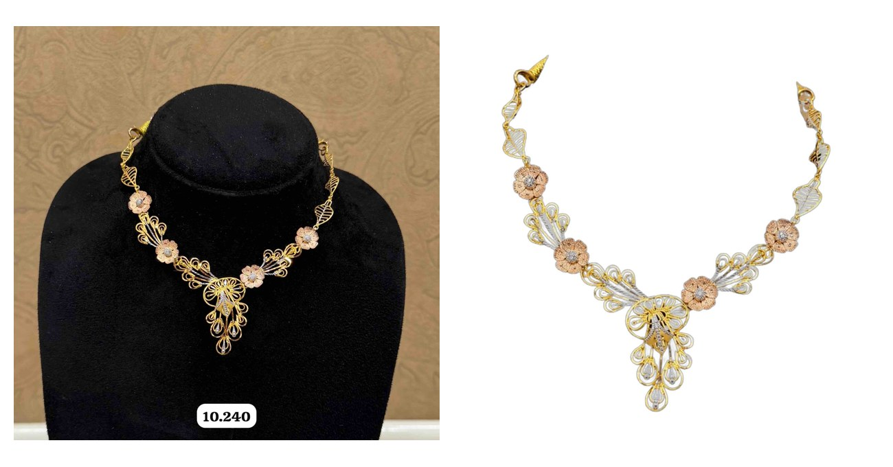
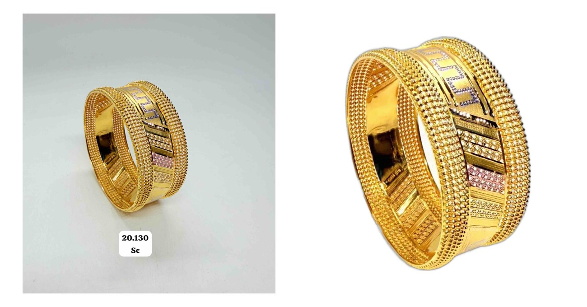
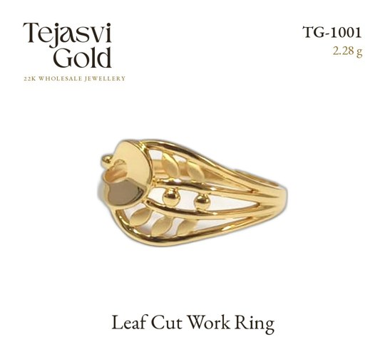

# Tejasvi Gold: from supplier catalogue photos to a WhatsApp-ready catalogue

I built the catalogue website for my family's 22K gold wholesale business, and an offline Python pipeline that turns the photos suppliers send us into clean, consistent product pictures. Live site: [tejasvigold.com](https://tejasvigold.com). This repo is the code only: no photos, prices, supplier names or contact details.

## What it does

Jewellery shops choose designs on WhatsApp. They need a clear picture, the weight, and one code to quote. Supplier photos arrive uneven: different lighting, tinted backgrounds, low resolution, weights printed on the image.

Left is the image exactly as it arrived in the supplier's PDF, with the weight printed on it. Right is what the pipeline produces: enlarged, cut out onto clean white, the weight read off the label and stored as text, and the same margin on every piece so a grid of them looks like one collection.

**Ring** (the original is a tiny piece in a wide photo, 1152 px across)



**Necklace** (on a display bust, against a patterned wall)



**Bangle** (tinted grey-blue background)



Each design also gets a ready-to-forward share card for WhatsApp:



## How a shop orders

Every design page has one button. It opens WhatsApp with the message already written, so the owner gets the design code and weight without asking:

```
Namaste,
Mujhe ye design ke baare mein jaankari chahiye:
Leaf Cut Work Ring – TG-1001 (2.28 g)
https://<site>/design/TG-1001/

Aaj ka bhav aur delivery bataiye.
```

The site itself is static (Astro on Vercel): no server, no database, so it loads fast on cheap phones.

## The pipeline (`tools/`)

| Step | Script | What it does |
|---|---|---|
| 1 | `import_catalogue.py` | Pulls each photo from a supplier PDF and reads the weight label with OCR |
| 2 | `upscale.py` | Enlarges with Real-ESRGAN (PyTorch) |
| 3 | `whiten.py` | Evens out off-white and tinted backgrounds |
| 4 | `remove_bg.py` | Cuts the piece out with rembg (isnet-general-use) |
| 5 | `thumbs.py` | Writes WebP at 480, 800 and 1200 px |
| 6 | `share_cards.py` | Makes a square WhatsApp card per design |
| 7 | `catalogue_pdf.py` | Builds a printable PDF catalogue of chosen designs |

## Decisions I'd defend

- **A wrong weight is worse than a missing one.** If OCR finds anything but exactly one plausible value, the design goes to a manual review sheet instead of being published.
- **Design codes are permanent.** A code a shop has quoted must always mean the same piece.
- **Same files in, same pictures out.** No random settings, and the model weights are checked against a SHA-256 hash before use.
- **Model licences matter.** The pipeline uses an Apache-2.0 segmentation model because the business is commercial.
- **Every step skips finished work**, so adding a new catalogue only processes its new photos.

## Run it

```
npm install
npm run dev     # sample data: 6 designs, no photos
npm test        # JavaScript tests
python3 -m unittest tests/test_import_catalogue.py
```

Pipeline setup and the plan for scaling to thousands of designs: [`tools/PIPELINE.md`](tools/PIPELINE.md).

**Stack:** Astro, JavaScript, CSS, Python, PyTorch, Real-ESRGAN, rembg (ONNX Runtime), Pillow, ReportLab, Vercel.
